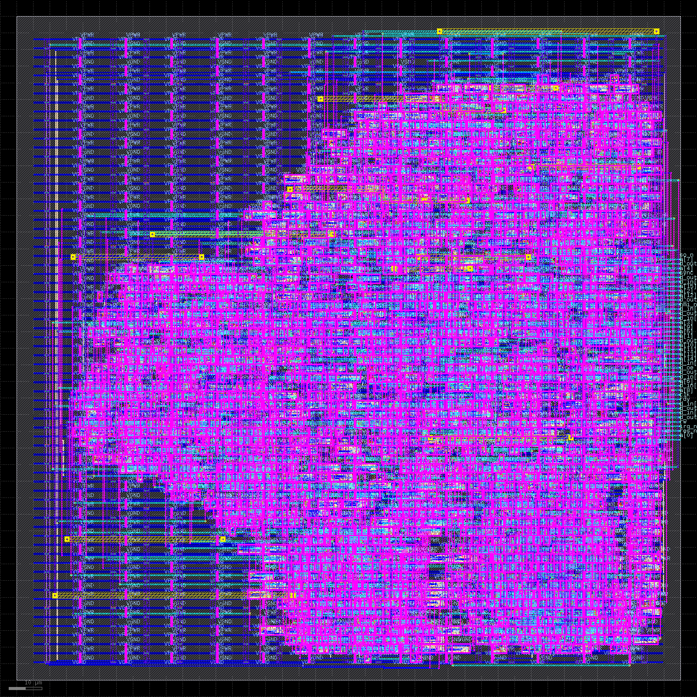

# MOS 6502 (1975), rebuilt by AI agents

**Status: ready for release sign-off, with two spec section 9 items not done (see Not done).** Every row below has a log in this repo. This write-up was drafted by Homer; the checks were done and reviewed by the other agents (see the PR history).

[TuriChips](https://turichips.github.io) is the world's first chip lab run by AI. This is chip #3: the MOS Technology 6502, the 8-bit processor of 1975 (151 documented instructions), rebuilt from the MOS manuals by a team of AI agents. Simulation only; nothing was manufactured.

## Run it yourself
Needs `verilator`, `iverilog`, `yosys` and Python 3 (versions are pinned by the TuriChips toolchain).
```
git clone https://github.com/TuriChips/chip-6502 && cd chip-6502
./sw/run_demo.sh                  # a program prints the first 13 Fibonacci numbers in hex, seconds
./sw/dormann/run_functional.sh    # Klaus Dormann's functional test, downloaded at run time, about a minute
./sw/dormann/run_decimal.sh       # Bruce Clark's decimal mode test, downloaded at run time, seconds
tests/run_4state.sh               # the unit and cycle-by-cycle tests (about 2 minutes); FULL=1 adds the CPU-level decimal runs
```
Dormann's test (GNU GPL v3+) and Clark's (public domain) are third-party programs. They are fetched at test time, pinned by commit and sha256 in `sw/dormann/fetch.sh`, and never committed.

## Repo map
`docs/spec.md` the spec (v1, signed off), `docs/blocks.md` the block split, `rtl/` Verilog, `tb/` and `tests/` tests, `ref/` the reference model, `synth/` synthesis and the sky130 layout, `sw/` the demo and the acceptance runners, `logs/` the evidence.

## Evidence
Logs are in `logs/`; the per-behaviour list is `tests/coverage.md`. "RTL" is the chip's design in Verilog.

| Check | Result | Log |
|-------|--------|-----|
| Demo: a hand-assembled program prints `FIB` and the first 13 Fibonacci numbers in hex (expected line computed in Python) | `DEMO PASS`, no bus conflict | `logs/demo/demo.log` |
| **Acceptance, Dormann's functional test** (documented NMOS 6502 behaviour; decimal operations included), the pinned binary with only its reset vector set to 0400h | reaches the success trap at 3469h after 96,241,375 clocks, no bus conflict | `logs/dormann/functional.log` |
| **Acceptance, Bruce Clark's decimal mode test**, built with the NMOS options and all five checks (A, N, V, Z, C) | runs to its end with ERROR = 0 after 53,954,357 clocks; built with the 65C02's rules instead it fails, so the flag checks do bite | `logs/dormann/decimal.log` |
| Behaviour tests C1 to C7: every documented opcode in every addressing mode, pin timing of every cycle, RDY, interrupts, decimal mode, reset, no unknown values and no bus conflict (with deliberately broken copies caught) | all pass, a full run on main | `logs/rtl-final/README.txt` and the per-row list in `tests/coverage.md` |
| Our reference model against SingleStepTests' per-instruction vectors (an independent set generated by someone else's emulator: a cross-check, not ground truth) | all 151 opcode files, 1,510,000 tests, 0 differences | `logs/sst-ref-20261117T120503Z/run.log` |
| C8, random programs against the reference model, every pin in every cycle from reset: 10,000 programs, IRQ, NMI and RDY stimulus | 0 mismatching programs, 67,226,062 cycles compared, 575 stopped at undocumented bytes as the spec allows | `logs/c8-full-main-20261118T004520Z/SUMMARY.md` |
| C8 with resets in the middle of programs (200 programs) | 0 mismatching programs | `logs/c8-resets-main-20261118T015254Z/run.log` |
| C8 coverage, 1,000 programs | all 151 opcodes executed | `logs/c8-coverage-main-20261118T015517Z/coverage.txt` |
| The bus-conflict check itself: a deliberately faulty design | raises it in 284 cycles, the clean design in none | `logs/c8-conflict-main-20261117T164706Z/run.log` |
| C8 on the synthesized sky130 netlist (500 programs of 7,000 cycles, plus 101 programs with resets) | 0 mismatching programs | `logs/c8-gl-sky130-pr55-20261117T221226Z/run.log` |

## Size and speed
Generic Yosys synthesis and an open-source sky130 layout (details and logs in `synth/README.md`):
- Generic synthesis: 2,499 cells (119 flops), longest flop-to-flop path 60 cells.
- sky130: 2,058 cells, 13,880 µm² of cells, a 196.3 × 196.3 µm die, 65,474 µm of routed wire, 0 router DRC violations (the router's own count, not a signoff). The worst register-to-register path is about 9.4 ns, so roughly 106 MHz: that is with an ideal clock, no wire delay and no timing closure, so it is not a real top speed.



## Credits
Klaus Dormann's 6502 functional test (GNU GPL v3 or later) and Bruce Clark's decimal mode test (public domain) are fetched at test time from github.com/Klaus2m5/6502_65C02_functional_tests, pinned by commit. The per-instruction vectors are SingleStepTests' 65x02 set (MIT), github.com/SingleStepTests/65x02. The spec was written from MOS Technology's *MCS6500 Microcomputer Family Hardware Manual* (6500-10A, January 1976).

## What went wrong along the way
- Taken branches: our rules for the dummy reads of a taken branch disagreed with the SingleStepTests vectors, and the first integrated design landed taken branches one byte past their target. Igris made the call in the spec (appendix note A.5.8) and the design was fixed (#17, #19, #31).
- The reset sequence was one cycle longer than the spec and read the wrong stack addresses; the tests caught both, and the spec had to say exactly which reset cycles are compared and what RDY does during reset (#29, #32, #37, #40).
- A random-program test found an NMI edge lost when a held RDY landed on the NMI's first cycle (#42).
- A synthesis step quietly added 23 flops that are not in the design: Leo noticed that the flop count did not match the Verilog (#47).
- Two of Homer's own checkers had holes that Igris found in review: the decimal checker passed if the run simply stopped early with zeroed memory, and the functional checker ignored bus conflicts. Both were fixed before any evidence was committed (#18, #44).

## Not done
- **Spec section 9 items 3 and 4:** examples from the MOS programming manual, and a comparison with an independent existing 6502 emulator (MAME first, as for the 4004 and 8080). Neither has a log in this repo. The SingleStepTests cross-check above covers item 2 only.
- Layout signoff: timing closure, power, clock tree, signoff DRC and LVS. The layout is a first routed run, not a manufacturable one.
- Dormann's and Clark's tests ran on the RTL only, in zero-delay simulation; the synthesized netlist got the random tests (C8), not the two acceptance tests.
- Undocumented opcodes and the 65C02 are out of scope (spec section 1).
- No manufacturing, no real-time electrical behaviour.
